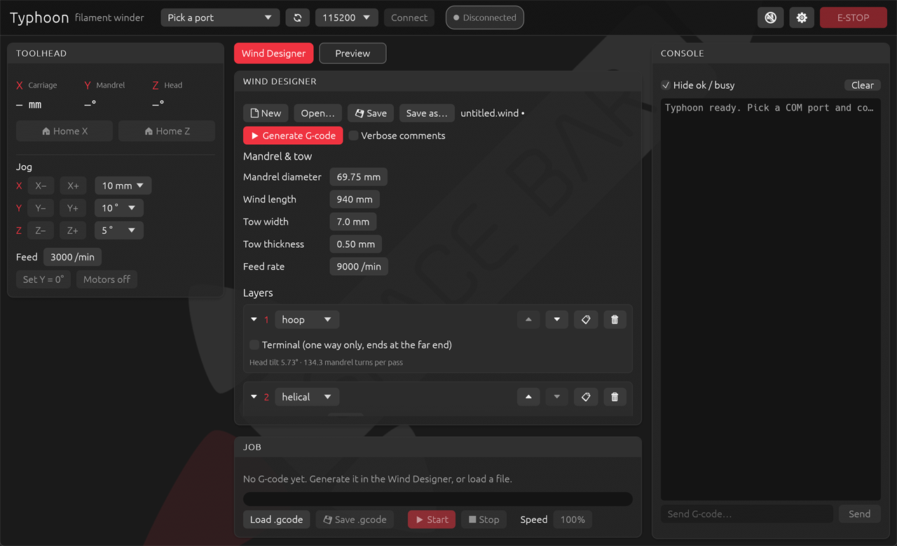
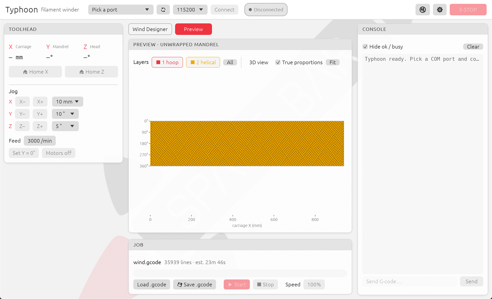
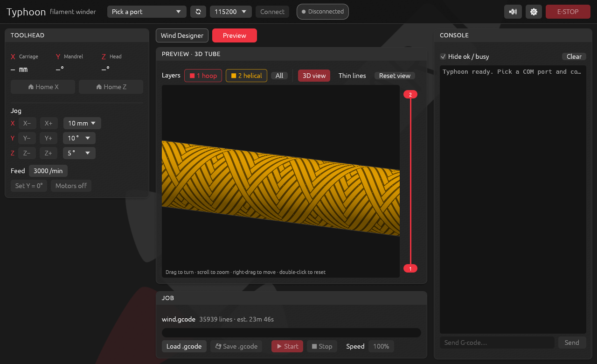
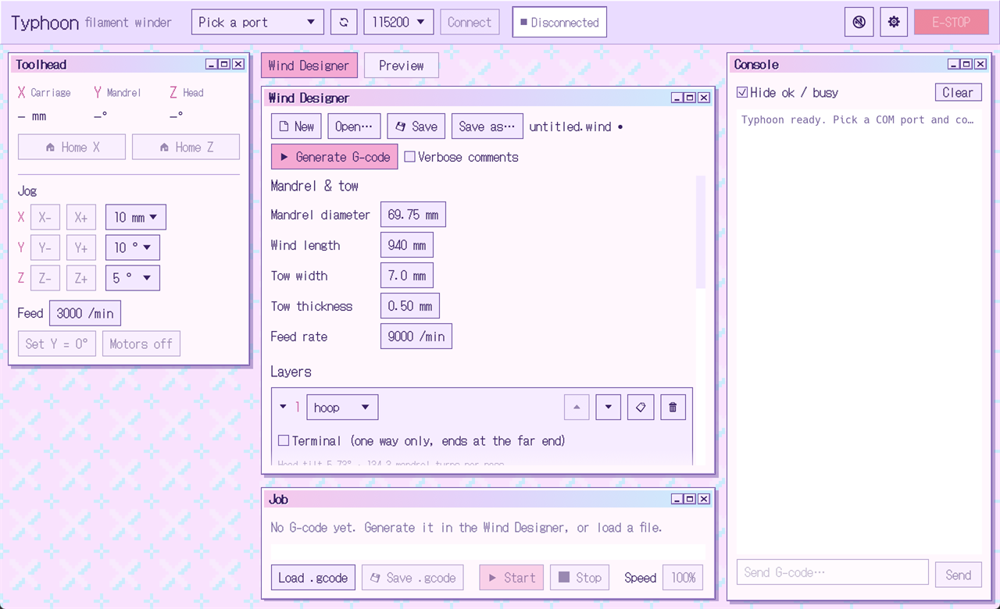

# Typhoon

A lightweight desktop app for a 3-axis filament winder running Marlin (built for
an MKS TinyBee with Marlin 2.0.9.2). It designs winds, generates the G-code,
previews the toolpath and streams it to the machine over USB serial, in a
Mainsail-style interface.

A project by [rnadomdude](https://github.com/rnadomdude). The G-code generator is
a Rust port of [cyclone](https://github.com/reilleya/cyclone) by
[Andrew Reilley](https://github.com/reilleya); for the same `.wind` file it
produces the same G-code, line for line. Licensed under GPL-3.0.



| Preview (unrolled mandrel) | Preview (3D view) |
|---|---|
|  |  |

## What it does

- **Wind Designer**: edit mandrel, tow and layers (hoop, helical, skip); loads and
  saves cyclone `.wind` files; flags pattern numbers that don't divide the
  circuit count and other mistakes; estimates time and tow length.
- **Preview**: the mandrel surface unrolled flat, tows at true width and angle,
  with a live marker while winding. An optional **3D view** draws the tow paths
  themselves on the tube, every pass a ribbon at true width like a slicer's
  preview (drag to turn, scroll to zoom; **Thin lines** shows the layers
  through each other). A slider beside either view picks the range of layers
  shown, and each layer sits at the angle it's really wound at, even though
  cyclone re-zeroes the mandrel between layers. The 3D paths are built once
  and drawn by the GPU, and nothing 3D exists until it's switched on, so old
  laptops cope.
- **Machine control**: COM port picker (USB ports first), console with history,
  jog, Home X / Home Z, set mandrel zero, motors off, E-STOP.
- **Jobs**: start checklist, pause/resume, stop, speed override, progress and ETA.
- **Alert sounds** (optional): ALR-67 RWR tones, Bambu A1-style beeps, chimes,
  plain beeps or the Overload clips, for errors, alerts, homing done and wind
  done (see below).
- **Light / dark / system themes**, plus **Overload**: a pastel Windows 98 /
  vaporwave theme with a pixel font, its own alert sounds and click pops.
  UI scaling for small screens.

Axes, as in cyclone: **X** carriage (mm), **Y** mandrel (degrees),
**Z** delivery head (degrees).

## Building

Install Rust with [rustup](https://rustup.rs), then in this folder:

```
cargo build --release
```

The app is `target/release/typhoon.exe` on Windows and `target/release/typhoon`
on Linux. It is a single file; copy it anywhere.

### Linux (e.g. the old laptop)

Build on the laptop itself, so the binary matches its system libraries:

```
sudo apt install build-essential          # Debian / Ubuntu / Mint
curl --proto '=https' --tlsv1.2 -sSf https://sh.rustup.rs | sh
cargo build --release
./target/release/typhoon
```

No other development packages are needed: X11/Wayland, OpenGL and keyboard
libraries are loaded at run time and come with any desktop install. The first
build takes a while on an old machine.

**Serial port access.** Linux only lets members of the serial group open ports.
Add yourself once, then log out and back in:

```
sudo usermod -aG dialout $USER        # "uucp" on Arch-based systems
```

The TinyBee shows up as `/dev/ttyUSB0` (or similar). If connecting acts
strangely, `ModemManager` may be probing the port:
`sudo systemctl stop ModemManager` (or uninstall it if you don't use a modem).

**Other notes**

- Sounds use `paplay` (PulseAudio / PipeWire), `pw-play` or `aplay`, whichever
  is installed.
- File dialogs use the desktop portal (`xdg-desktop-portal`, present on normal
  desktop installs).
- The 3D preview draws with OpenGL (3.3, ES 2.0 or an older compatibility
  profile, whichever the driver offers). If the driver can't run it, the view
  shows why instead.
- During a job, Typhoon asks systemd (`systemd-inhibit`) to keep the machine
  from sleeping. Closing the lid can still suspend it depending on your power
  settings, so keep the lid open.

To add a menu entry, save this as `~/.local/share/applications/typhoon.desktop`
(adjust the path):

```
[Desktop Entry]
Type=Application
Name=Typhoon
Comment=Filament winder control
Exec=/home/YOU/typhoon/target/release/typhoon
Terminal=false
Categories=Utility;Engineering;
```

## Alert sounds

Sounds play only for errors (job failed, board halted, connection lost), alerts
(job paused, board not answering), homing done and wind done. Choose a preset or
a sound per alert in **Preferences > Sound** and press ▶ to hear it; the speaker
button in the top bar mutes everything. Sounds are synthesized by the app, with
no sound files.

**ALR-67 RWR tones** follow the frequencies and timings documented for the
AN/ALR-67 radar warning receiver:

| Tone | Used for | Pattern |
|---|---|---|
| Missile launch | Error | 455 / 555 Hz alternating, 0.166 s each |
| Lock (single target track) | Alert | 455 / 555 Hz alternating, 0.5 s each |
| Status change | Homing done | one 455 Hz tone, 0.33 s |
| Special (four-tone) | Wind done | 550, 520, 490, 470 Hz, 0.083 s each |
| Airborne interceptor | (optional) | 555 Hz on/off, 0.5 s each |
| AAA | (optional) | 555 Hz on/off every 0.166 s |

Sources: the [VRS Superbug wiki](https://forums.vrsimulations.com/support/index.php/Tactical_Electronic_Warfare_(EW)_Systems)
("ALR-67 Audio Tones") for every tone except the four-tone, which comes from the
[Heatblur F-14 manual](https://f14.manuals.heatblur.se/f14ab/systems/defensive_systems/rwr/alr_67.html)
(a falling four-tone signal) and DCS community notes (its frequencies). The waveform itself isn't
documented, so Typhoon uses a square-wave tone.

**Bambu A1-style** sounds use a low, growly stepper-motor timbre (the A1 makes its
sounds with its motors): the error is a beep-beep on G3 followed by another a
semitone lower. Bambu doesn't publish what its error sound is, so this is a
lookalike, not a copy.

**Overload** uses chiptune bleeps: square-wave notes with pitch glides and
stepped volume envelopes, built from measurements of short game-style clips.
Per-per (two falling blips) is for errors, Tutorial pop (a rising C–G–E
arpeggio) for alerts, Nade-nade (two rising "pyu" chirps) for homing done and
the long Nade-nade (four) for wind done. Picking the Overload theme switches to
this preset; switching to another
theme puts your previous choices back. In Overload, clicking a button, tab,
checkbox or dropdown also plays a quiet pop (turn it off with **Pop on every
click**). A pop never cuts off an alert that's already playing.

## Overload theme

Pick **💗 Overload** in **Preferences > Appearance**. Cards become Windows 98
windows with gradient title bars (their minimise, maximise and close boxes are
only decoration), on a desktop tiled with pixel-art X's and sparkles
(`assets/overload-tile.svg`) instead of the Space Bar logo.
Start buttons, progress and the selected tab turn hot pink, but E-STOP, stop
buttons and errors stay red in every theme.



The pixel font is [DotGothic16](https://github.com/fontworks-fonts/DotGothic16), used
under the SIL Open Font License (`assets/fonts/OFL.txt`).

## Before the first real wind

Check the Marlin configuration on the TinyBee:

- `BAUDRATE` matches the baud rate picked in Typhoon (115200 by default).
- **Y (mandrel)**: software endstops off or very wide; a wind turns it through
  tens of thousands of degrees.
- **Z (delivery head)**: Home Z homes into the limit switch, then Typhoon sets
  Z to the switch angle (Preferences > Machine, default −90°) so Z 0° is the flat
  neutral position. Use −90° if Z homes toward Z-min, +90° toward Z-max. Allow at
  least ~180° between `Z_MIN_POS` and `Z_MAX_POS`.
- `EMERGENCY_PARSER` makes E-STOP (`M112`) act immediately instead of waiting
  behind moves the board has already queued.

Try it first with the built-in **Simulator** port, then a short wind on the
machine without tow.

## Files

Settings live in the usual app-data folder (`%APPDATA%\Typhoon\data` on Windows,
`~/.local/share/typhoon` on Linux). If the app ever crashes, details are written
to `crash.log` in that folder. Set `TYPHOON_DATA_DIR` to run a second copy with
its own settings.

## Tests

```
cargo test
```

The planner tests compare against G-code recorded from cyclone itself
(`tests/fixtures`); the serial tests stream jobs to the built-in simulator with
injected transmission errors.
